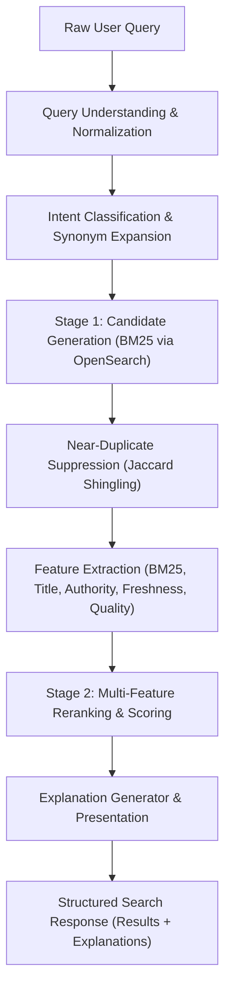

# OM Search — Phase 3: Ranking Architecture

## 1. Overview and Design Philosophy

OM Search implements an independent, modular Information Retrieval (IR) architecture designed for transparency, reproducibility, and explainability. Rather than treating ranking as an opaque heuristic or relying on proprietary black-box APIs, Phase 3 establishes a disciplined two-stage retrieval and reranking pipeline.



---

## 2. Pipeline Stages

### Stage 1: Candidate Generation
- **Engine**: OpenSearch (with in-memory BM25 fallback for offline / resource-constrained operation).
- **Retrieval Size**: Configured via `RankingConfig.stage1_candidate_pool_size` (default: 50 candidates).
- **BM25 Weights**:
  - Title boost: `title^3.0`
  - Snippet boost: `snippet^1.5`
  - Body content: `content^1.0`
- **Candidate Pool**: Casts a wide net to achieve high Recall@50 before computationally expensive reranking is applied.

### Near-Duplicate Suppression
- **Mechanism**: Word 3-gram shingles with Jaccard coefficient calculation.
- **Threshold**: `0.70` similarity threshold.
- **Action**: Duplicates from lower-scoring or mirror domains are suppressed from the top rankings, preserving ranking slots for genuinely distinct sources.

### Stage 2: Multi-Feature Reranking
- **Model**: Linear additive scoring with query-intent gating.
- **Formula**:
  $$S(d, q) = w_{\text{bm25}} \cdot f_{\text{bm25}} + w_{\text{title}} \cdot f_{\text{title}} + w_{\text{auth}} \cdot f_{\text{auth}} + w_{\text{fresh}} \cdot f_{\text{fresh}} + w_{\text{qual}} \cdot f_{\text{qual}} - w_{\text{spam}} \cdot f_{\text{spam}}$$
- **Normalization**:
  - BM25 scores normalized relative to the maximum score in the candidate pool:
    $$f_{\text{bm25}} = \frac{s_i}{\max(s) + \epsilon}$$
  - All feature scores bounded within $[0.0, 1.0]$.
  - Weights normalized to sum to $1.0$ (with spam risk as a subtraction penalty).

---

## 3. Query Understanding Pipeline

The query understanding subsystem transforms raw input into structured query representations:

1. **Unicode Normalization**: NFKC normalization to collapse ligature and character discrepancies.
2. **Quoted Phrase Extraction**: Extracts exact phrases (`"search engine"`) and strips punctuation from unquoted terms.
3. **Identifier Preservation**: Identifies CamelCase (`JavaScript`), snake_case (`page_links`), dotted symbols (`python.org`), and URLs without stripping semantic delimiters.
4. **Intent Classification**:
   - `Navigational`: Contains domain markers (`.com`, `.org`, `www.`) or explicit site searches.
   - `Freshness`: Contains temporal tokens (`latest`, `recent`, `today`, `2024`, `2025`, `2026`).
   - `Technical`: Contains technical markers (`def`, `function`, `api`, `class`, `import`, `install`).
   - `Informational`: General informative queries (`what is`, `how to`, `tutorial`, `guide`).
5. **Synonym Expansion**: Domain-curated synonyms (e.g., `py` $\rightarrow$ `python`, `postgres` $\rightarrow$ `postgresql`, `db` $\rightarrow$ `database`).
6. **Spelling Suggestions**: Damerau-Levenshtein distance against corpus vocabulary for single-edit typos without aggressive over-correction.

---

## 4. Link Analysis and Authority (PageRank)

- **Graph Storage**:
  - `page_links`: Directed edges `(from_url_id, to_url_id)`.
  - `page_authority`: Persisted PageRank values `(url_id, pagerank, in_degree, out_degree)`.
- **Computation**: Deterministic power iteration with uniform redistribution of dangling node mass:
  $$PR_{t+1}(u) = \frac{1 - d}{N} + d \left( \sum_{v \in B(u)} \frac{PR_t(v)}{L(v)} + \frac{\text{dangling\_mass}}{N} \right)$$
- **Damping Factor**: $d = 0.85$.
- **Convergence**: $\epsilon = 10^{-6}$ or maximum 50 iterations.
- **Normalization**: Min-max log scaling to prevent mega-hubs from completely drowning out niche content.

---

## 5. Explainability and Inspection

When `explain=true` is supplied to `/api/v1/search`:
- Each result item returns a structured breakdown:
  ```json
  "explanation": {
    "final_score": 0.8421,
    "reasons": [
      "High textual relevance (BM25: 12.45)",
      "Exact title coverage match (100%)",
      "High link authority (PageRank: 0.72)",
      "High content quality (quality: 0.85, spam risk: 0.0)"
    ]
  },
  "features": {
    "bm25_raw": 12.45,
    "bm25_norm": 1.0,
    "title_coverage": 1.0,
    "exact_title_match": 1.0,
    "phrase_match": 1.0,
    "authority": 0.72,
    "freshness": 0.95,
    "quality": 0.85,
    "spam_risk": 0.0
  }
  ```
