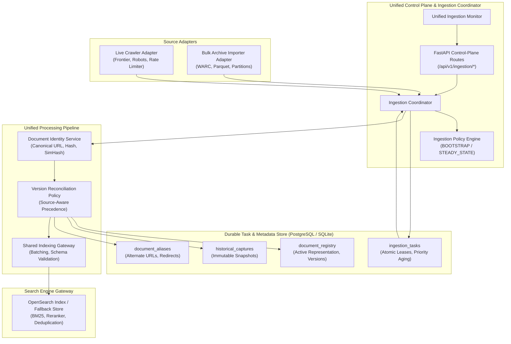

# OM Search — Unified Crawler & Massive Indexing Architecture

## 1. Executive Summary & Purpose

The **OM Search Unified Ingestion Platform** unifies the **Phase 2 Live Web Crawler** and the **Phase 2 Massive Bulk Archive Importer** into a single, coordinated, distributed ingestion engine. It ensures:

1. **Maximized Web Coverage & Freshness**: Balances fast live web discovery with high-throughput historical archive imports.
2. **Deterministic Document Identity & Provenance**: Disentangles URL identity, canonical identity, exact content fingerprinting, and historical capture state without collapsing them into a single fragile hash or database row.
3. **Source-Aware Version Reconciliation**: Strictly prevents older historical archive snapshots from overwriting newer live web documents, while preserving historical captures immutably for research and audit.
4. **Durable Distributed Task Scheduling**: Atomic task claims, expiring leases, automatic lease recovery from worker crashes, and dynamic queue aging to eliminate task starvation.
5. **Bidirectional Index Reconciliation & Resilience**: Decouples PostgreSQL metadata persistence from OpenSearch indexing; unindexed or failed writes are systematically reconciled without search outage.
6. **Zero-Dollar Local Operations**: Fully validated in local developer environments running on Windows with local PostgreSQL/SQLite fallback and OpenSearch/In-Memory fallback indexing.

---

## 2. Target Architecture & Component Topology



---

## 3. Shared Identity & Version Conflict Policy

### 3.1 Five-Tier Document Identity Model

| Identity Tier | Identifier | Purpose & Semantics |
| :--- | :--- | :--- |
| **A. URL Identity** | `raw_url` | Exact URL discovered on the web or in an archive header, including query parameters and tracking tokens. |
| **B. Canonical URL Identity** | `canonical_url` & `doc_id` | Deterministically normalized URL (strip tracking tokens, sort queries, strip fragments, lowercase domain). `doc_id` is a 24-character hexadecimal hash of the canonical URL. |
| **C. Content Identity** | `content_hash` & `simhash` | SHA-256 fingerprint for exact duplicate detection; 64-bit SimHash for near-duplicate and boilerplate suppression. |
| **D. Historical Capture Identity** | `capture_id` | Immutable snapshot identifier (e.g. `cap_9a8f...`) representing a specific point-in-time observation of a page. |
| **E. Searchable Document** | OpenSearch Document | The single active representation of a document surfaced in BM25 query results. Only one canonical document exists in search results per canonical URL. |
| **F. Provenance Identity** | `source_type` & `source_archive_id` | Tracks whether the document originated from live crawl, WARC archive batch, or operator seed. |

### 3.2 Source-Aware Version Reconciliation Matrix

| Incoming Source | Active Source in Registry | Timestamps Evaluated | Content Hash Comparison | Decision & Action |
| :--- | :--- | :--- | :--- | :--- |
| **Live Crawler** | *None (New Doc)* | `live_fetched_at` | First seen | **`update_searchable`**: Register as v1, publish to OpenSearch, save capture. |
| **Bulk Archive** | *None (New Doc)* | `source_captured_at` | First seen | **`update_searchable`**: Register as v1, publish to OpenSearch, save capture. |
| **Bulk Archive** | **Live Crawler** | Archive older than Live | Any | **`archive_capture_only`**: Reject overwriting live index. Append immutable `HistoricalCapture`. Active search remains fresh live page. |
| **Bulk Archive** | **Live Crawler** | Missing Archive Timestamp | Any | **`archive_capture_only`**: Mark uncertain. Reject overwriting live index. Append capture. |
| **Live Crawler** | **Bulk Archive** | `live_fetched_at >= captured_at` | Different | **`update_searchable`**: Live crawl supersedes historical archive. Bump `version_sequence`, update OpenSearch, append capture. |
| **Any Source** | **Any Source** | Any | Identical | **`skip_identical`**: Record capture or touch timestamp. Avoid redundant re-indexing and OpenSearch churn. |
| **Bulk Archive** | **Bulk Archive** | Incoming $\le$ Existing Capture | Different | **`archive_capture_only`**: Retain newer archive as searchable; record older as capture. |

---

## 4. Durable Scheduler & Priority Fairness

### 4.1 Scheduling Profiles

The coordinator supports two runtime policy profiles:

1. **`BOOTSTRAP` Profile**:
   - Used for initial index population and massive historical bulk imports.
   - Archive importer budget: 8 workers (70% capacity).
   - Live crawler budget: 3 workers (retains reserved 30% capacity for discovery).
2. **`STEADY_STATE` Profile**:
   - Used for normal production operations.
   - Live crawler budget: 6 workers (70% capacity) for fresh link discovery and recrawl updates.
   - Archive importer budget: 3 workers (30% capacity) for background archive processing.

### 4.2 Dynamic Priority Scoring & Starvation Prevention

Tasks are scheduled using dynamic scoring that ages over time:

$$\text{Dynamic Score} = \text{Base Multiplier} + \text{Operator Priority} + (\text{Age in Minutes} \times 0.5)$$

Where `Base Multiplier` is:
- **`URGENT`**: 100.0
- **`ROUTINE`** (Live Discovery): 20.0
- **`BULK_ARCHIVE`**: 10.0
- **`RETRY`**: 5.0

Because score increases with queue wait time, eligible bulk archive and retry tasks will naturally advance in priority, guaranteeing zero indefinite starvation.

### 4.3 Atomic Lease Execution & Crash Recovery

- **Atomic Claims**: Tasks are leased to workers with an expiring timestamp (`lease_expires_at = now + lease_seconds`).
- **Concurrent Safety**: Workers cannot claim tasks already leased or paused by policy.
- **Crash Recovery**: When a worker process crashes, its lease expires. The scheduler's `reclaim_expired_leases()` method automatically resets timed-out tasks to `PENDING` without manual operator intervention.

---

## 5. Control-Plane API Specification

All ingestion control routes are mounted under `/api/v1/ingestion` and require the operator authentication header:
`X-Operator-Token: om-operator-secret-key-2026`.

| Endpoint | Method | Description |
| :--- | :--- | :--- |
| `/api/v1/ingestion/status` | `GET` | Full operational telemetry (active sources, documents, frontier, queues, throughput). |
| `/api/v1/ingestion/queues` | `GET` | Queue depths across `pending`, `leased`, `completed`, `failed`, and `dead_letter`. |
| `/api/v1/ingestion/policies` | `GET` | Current active scheduling profile (`BOOTSTRAP`/`STEADY_STATE`), budgets, and pause state. |
| `/api/v1/ingestion/policies` | `POST` | Update scheduling profile (e.g. `{"profile": "BOOTSTRAP"}`). |
| `/api/v1/ingestion/pause` | `POST` | Pause ingestion globally or for a specific source (`?source_type=archive_importer`). |
| `/api/v1/ingestion/resume` | `POST` | Resume ingestion globally or for a specific source (`?source_type=archive_importer`). |
| `/api/v1/ingestion/tasks/{task_id}` | `GET` | Inspect task parameters, attempts, errors, and lease details. |
| `/api/v1/ingestion/tasks/replay` | `POST` | Replay dead-letter or failed tasks back into the pending queue. |
| `/api/v1/ingestion/reconcile` | `POST` | Trigger bidirectional database/OpenSearch reconciliation for unindexed documents. |
| `/api/v1/ingestion/cycle` | `POST` | Trigger an explicit coordinated ingestion cycle on demand. |

---

## 6. Verification & Automated Test Coverage

The test suite contains **94 automated tests** covering all phases and components:

```
tests/test_api_integration.py                       18 passed
tests/test_crawler_api.py                            6 passed
tests/test_crawler_e2e_fixture.py                    1 passed
tests/test_crawler_extractor.py                      7 passed
tests/test_crawler_frontier.py                       6 passed
tests/test_crawler_network_safety.py                 6 passed
tests/test_crawler_robots.py                         8 passed
tests/test_crawler_url_normalizer.py                 6 passed
tests/test_evaluation_metrics.py                     2 passed
tests/test_indexing_gateway_and_reconciliation.py     3 passed
tests/test_ingestion_pipeline.py                     3 passed
tests/test_normalizer.py                             4 passed
tests/test_query_validation.py                       3 passed
tests/test_ranking.py                                3 passed
tests/test_ranking_pagerank.py                       2 passed
tests/test_ranking_pipeline.py                       2 passed
tests/test_ranking_query_processor.py                2 passed
tests/test_unified_control_plane_api.py              5 passed
tests/test_unified_identity_and_versioning.py        5 passed
tests/test_unified_ingestion_e2e.py                  1 passed
tests/test_unified_scheduler_and_policy.py           6 passed
------------------------------------------------------------
TOTAL: 94 PASSED (0 failures, 0 regressions)
```

### End-to-End Acceptance Test (`test_unified_ingestion_e2e.py`)

Deterministic verification verifying all 10 requirements of Prompt Section 19:
1. Both sources submit work concurrently.
2. Scheduler allocates work according to policy.
3. Duplicate records create aliases without duplicate search results.
4. Older archive records cannot overwrite newer valid live content.
5. Historical provenance remains preserved in `historical_captures`.
6. Failed writes recover safely through retries and exponential backoff.
7. Workers resume after simulated crash without corrupting task state.
8. OM search endpoint returns the correct current live document.
9. Source-specific progress reports and queue depths remain accurate.
10. Global and per-source pause/resume controls work cleanly.

---

## 7. Execution Guide

### Run All Automated Tests
```powershell
.venv\Scripts\pytest -q
```

### Run Unified Ingestion Tests
```powershell
.venv\Scripts\pytest backend/tests/test_unified_identity_and_versioning.py backend/tests/test_unified_scheduler_and_policy.py backend/tests/test_indexing_gateway_and_reconciliation.py backend/tests/test_unified_control_plane_api.py backend/tests/test_unified_ingestion_e2e.py -v
```

### Start Backend Control Plane
```powershell
.venv\Scripts\uvicorn app.main:app --host 127.0.0.1 --port 8000 --reload
```

### Trigger Ingestion Cycle via API
```bash
curl -X POST "http://127.0.0.1:8000/api/v1/ingestion/cycle?max_tasks=10" \
     -H "X-Operator-Token: om-operator-secret-key-2026"
```
