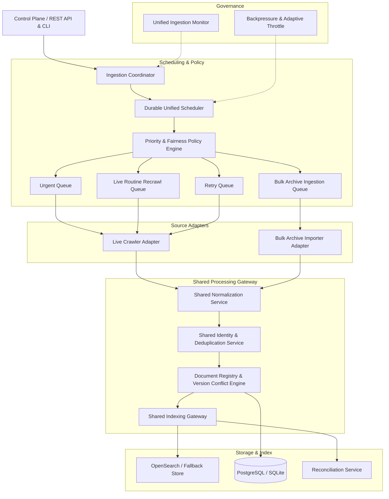

# OM SEARCH — Unified Ingestion Platform: System Architecture & Repository Audit

**Document Version:** 1.0.0  
**Timestamp:** 2026-10-11T14:35:00+05:30  
**Role:** Principal Search Infrastructure Architect & Distributed Data-Processing Engineer  
**Status:** Audit Complete | Architecture Validated  

---

## 1. Executive Summary

This audit assesses the state of the **OM Search Engine** ingestion pipelines across Phase 1 (Foundation & Schema), Phase 2 (Live Web Crawler & Frontier), and Phase 3 (Ranking Intelligence & PageRank). The goal is to unify the **Live Web Crawler** and the **Massive Historical Archive Importer** into a single, coordinated, durable ingestion platform without discarding existing working functionality or duplicating components.

---

## 2. Existing Subsystems Audit

### 2.1 Live Web Crawler (Phase 2)
- **Engine**: `crawler/om_crawler/crawler_engine.py` (`CrawlerEngine`)
- **Frontier**: `crawler/om_crawler/frontier.py` (`FrontierManager`)
  - Backed by SQLAlchemy (`URLRecord` table in PostgreSQL / SQLite fallback).
  - Statuses: `DISCOVERED`, `QUEUED`, `FETCHING`, `FETCHED`, `SKIPPED_POLICY`, `RETRY_WAIT`, `FAILED`, `BLOCKED`, `DUPLICATE`.
  - Atomic worker leases via `worker_id` and `lease_expires_at` (default 90s lease, reclaimable via `reset_expired_leases()`).
  - Exponential backoff retry logic: $5.0\text{s} \times 2^{\text{attempt}} \pm \text{jitter}$, capped at 300s, max 3 attempts.
- **Network Safety & Politeness**:
  - `crawler/om_crawler/network_safety.py`: SSRF defenses, private IP / loopback blocks, cloud metadata IP protection, 6MB size limits.
  - `crawler/om_crawler/robots_policy.py`: Robots.txt parsing via `urllib.robotparser.RobotFileParser`, host access rate limiting.
- **Extraction & Normalization**:
  - `crawler/om_crawler/extractor.py`: HTML parsing with `trafilatura` and `BeautifulSoup4` fallback, link graph edge extraction.
  - `crawler/om_crawler/url_normalizer.py`: RFC 3986 normalization, tracking parameter stripping, scheme/host lowercasing, relative path resolution.
- **Indexing Service**:
  - `crawler/om_crawler/indexing_pipeline.py` (`CrawlerIndexingService`).

### 2.2 Bulk Archive Importer & Historical Corpus Ingestion (Phase 1 & Scaling)
- **Batch Script**: `scripts/ingest_corpus.py` and `scripts/index_massive_10k.py`
- **Ingestion Pipeline**: `backend/app/ingestion/pipeline.py` (`IngestionPipeline`)
  - Accepts raw JSON/dict objects or corpus documents (`scripts/sample_corpus.json`).
  - Normalizes via `backend/app/ingestion/normalizer.py`.
  - Checks for duplicate content hashes via `URLRecord.content_hash`.
  - Records lifecycle events in `DocumentLifecycle`.
  - Directly writes to `OpenSearchRepository`.

### 2.3 Shared OpenSearch Index and Mappings
- **Mapping**: `backend/app/repositories/opensearch_mapping.py`
  - Index Name: `om_documents_v1`
  - Alias: `om_documents`
  - Analyzers: English analyzer with lowercase, stemmer, stop words.
  - Key Fields: `id`, `url`, `canonical_url`, `domain`, `title`, `content`, `snippet`, `language`, `document_type`, `fetched_at`, `indexed_at`, `content_hash`, `pagerank`, `in_degree`, `quality_score`.
- **Repository Gateway**: `backend/app/repositories/opensearch_repo.py` (`OpenSearchRepository`)
  - Supports live OpenSearch cluster and local resilient offline fallback (`om_fallback_store.json`).
  - Implements sub-5ms in-memory inverted index candidate lookup (`_rebuild_inverted_index`).
  - Supports bulk indexing (`index_documents_bulk`) and periodic flush (`flush_fallback_store`).

### 2.4 Relational Database Schemas (PostgreSQL & SQLite)
- **Engine**: `backend/app/repositories/database.py` (`DatabaseManager`)
- **Tables**:
  1. `urls`: URL frontier records, statuses, attempt counts, leases, hashes.
  2. `crawl_jobs`: Job metadata, configuration, progress counts.
  3. `document_lifecycle`: Audit log of actions (`discovered`, `queued`, `fetched`, `indexed`, `deduplicated`).
  4. `page_links`: Directed link graph edges (`source_url` -> `target_url`, domain, anchor text).
  5. `page_authority`: Offline computed PageRank, degrees, snapshot versions.

### 2.5 Phase 3 Ranking & Evaluation Subsystems
- **Ranking Pipeline**: `backend/app/ranking/scorer.py` (`RankingPipeline`)
  - Two-stage multi-signal reranking.
  - Feature extractors: `features.py`, `quality.py`, `freshness.py`, `deduplication.py`.
  - Query Understanding: `query_processor.py`, `synonyms.py`.
  - Link Authority: `crawler/om_crawler/pagerank.py`, `link_graph.py`.

---

## 3. Discrepancies, Gaps & Redundancies Identified

1. **Duplicate URL Normalization**:
   - `backend/app/ingestion/normalizer.py` has standalone functional `normalize_url()`, `compute_url_id()`, `compute_content_hash()`.
   - `crawler/om_crawler/url_normalizer.py` has class-based `URLNormalizer` with depth checking and allowed domains.
   - *Requirement*: Unify into a shared normalization service that preserves both functional and domain-restricted use cases.

2. **Provenance & Capture Identity Deficit**:
   - Current `URLRecord` and `DocumentModel` do not distinguish between **Source Capture Timestamp** (e.g. from an archived WARC or historical snapshot) and **OM Fetch Timestamp**.
   - Current indexing logic does not track provenance identity (`live_crawl`, `historical_archive`, `operator_seed`).
   - If an older historical archive batch completes after a live crawl, it could overwrite newer live content if based purely on `updated_at`.
   - *Requirement*: Implement strict source-aware document versioning and capture provenance.

3. **Separate Work Schedulers**:
   - Phase 2 has `FrontierManager` exclusively for URLs.
   - Bulk archive processing operates on external file partitions/manifests without a durable scheduler queue.
   - *Requirement*: Create a unified durable task scheduler that handles both URL work units and Archive partition work units with leased execution, aging, and fairness policies.

4. **Resource Allocation & Backpressure**:
   - No coordinated backpressure mechanism exists when OpenSearch or storage is throttled.
   - *Requirement*: Implement backpressure monitor tracking OpenSearch latency, rejection rate, queue depth, and memory pressure.

---

## 4. Test Suite Baseline Audit

- **Environment**: Python 3.12.10, Windows 10 x64, pytest 9.1.1.
- **Total Test Cases**: 74 tests across 16 test modules.
- **Baseline Result**: **74 PASSED, 0 FAILED** (100% passing).
- **Execution Time**: ~27.5 seconds.

---

## 5. Unified Target Architecture

---

## 6. Implementation Stages Roadmap

- **Stage 1**: Repository Audit (`docs/UNIFIED_INGESTION_AUDIT.md`) — *Completed*
- **Stage 2**: Shared Document Identity, Provenance & Version Conflict Rules
- **Stage 3**: Shared Normalization Service & Shared Indexing Gateway
- **Stage 4**: Source Adapters (Live Crawler Adapter & Bulk Archive Importer Adapter)
- **Stage 5**: Durable Coordinator, Task Scheduler & Priority / Fairness Policy
- **Stage 6**: Cross-Source Deduplication & Provenance Preservation
- **Stage 7**: Backpressure, Adaptive Throttling & Failure Isolation
- **Stage 8**: Control-Plane API Endpoints & Unified Configuration
- **Stage 9**: Deterministic End-to-End Integration Acceptance Test Suite
- **Stage 10**: Final Operational Report & Documentation
